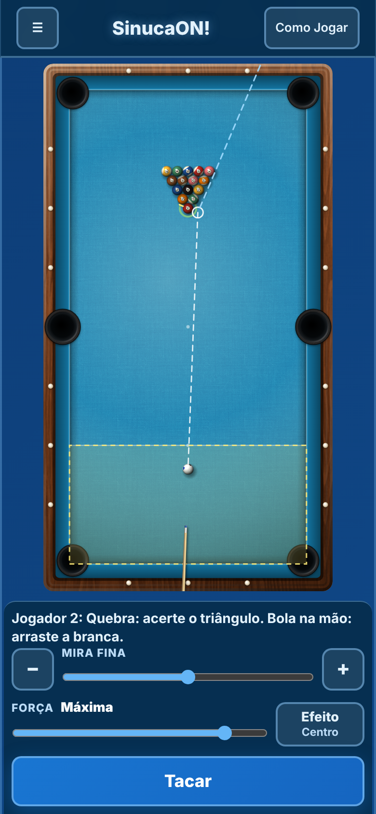
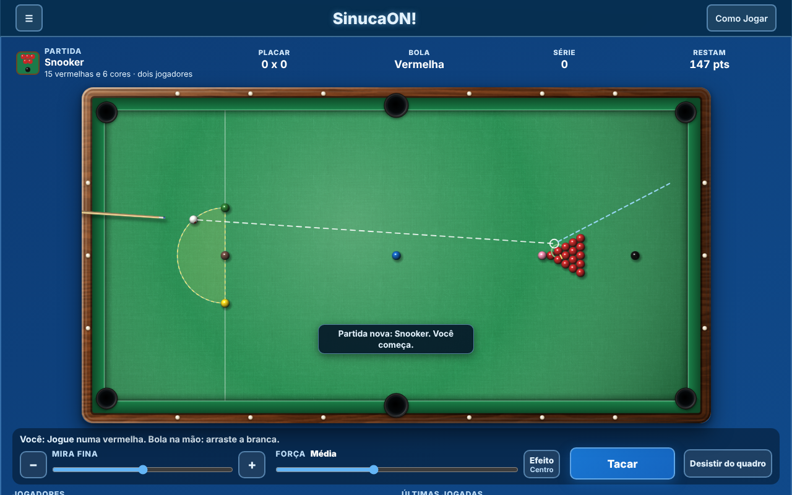

# SinucaON!

Sinuca no navegador com **física de verdade**: Sinuca Brasileira, Snooker, Bola 8 e Bola 9, contra **robôs de 3 níveis** ou a dois no mesmo aparelho. As bolas rolam, deslizam, giram e rebatem como na mesa, com efeito, quinas das caçapas e tabelas. Funciona no navegador ou instalado como app, inclusive sem internet.

**Jogue:** https://sinucaon.netlify.app/ · **Mais jogos:** https://speccygames.netlify.app/

  
  &nbsp;&nbsp;
  

## Como jogar

1. Toque no botão da partida, no alto da tela, e escolha o **modo**, o **adversário** (robô Fácil, Médio ou Difícil, ou outra pessoa no mesmo aparelho), o tamanho da partida e, no Bola 8, se a caçapa da bola 8 é cantada. Depois toque em **Jogar**.
2. Na sua vez, **arraste ou toque na mesa** para mirar. A linha mostra a primeira bola que a branca vai tocar e para onde ela vai; a **Mira fina** ajusta o ângulo em frações de grau.
3. Escolha a **Força** e, se quiser, o **Efeito** (ponto onde o taco bate na branca) e toque em **Tacar**.
4. Com **bola na mão**, arraste a branca até onde a regra permite. No Bola 8, para encaçapar a bola 8 toque na caçapa que você escolheu.
5. O diário mostra o que aconteceu em cada jogada, inclusive as faltas e o motivo. A partida termina quando alguém fecha os quadros escolhidos.

O botão **Como Jogar** do topo explica o site, as regras de cada modo, a física e traz dicas. Na primeira visita ele abre sozinho.

## Os modos

- **Sinuca Brasileira** (regras da AMB): sete bolas, bola da vez, saída, complementar e a bola visada.
- **Snooker** (regras da WPBSA): 15 vermelhas e 6 cores, sequência vermelha e cor, faltas de 4 a 7 pontos, bolas recolocadas, bola livre, desempate na preta e a opção de desistir do quadro.
- **Bola 8** (regras da WPA): lisas contra listradas, mesa aberta, bola 8 na caçapa cantada, quebra e bola na mão.
- **Bola 9** (regras da WPA): sempre a bola mais baixa, bola 9 vale o quadro, empurrada, três faltas seguidas perdem o quadro.

## A física

Um motor **por eventos**, sem passos de tempo: calcula o instante exato de cada choque entre bolas, de cada batida na tabela, na quina da caçapa e de cada mudança entre deslizar e rolar. As bolas têm posição, velocidade e rotação nos três eixos, com atrito de deslizamento e de rolamento, atrito entre bolas, modelo de tabela com perda de energia e efeito pelo ponto de contato do taco. O desenho mostra as bolas girando de verdade (o número e o ponto da bola acompanham a rotação).

Ficaram **fora** do motor: massé, jump, taco levantado e o desvio da branca causado pelo efeito lateral (squirt).

## Os robôs

Para cada bola e cada caçapa, o robô cria candidatas (tacadas diretas, rebatidas e jogadas de segurança), **simula cada uma com o mesmo motor** do jogo e escolhe a de melhor resultado. Cada candidata é avaliada também com pequenos erros de ângulo e de força, para ele não apostar em tacada que só sai com mira perfeita. O nível muda o tamanho do erro dele e o corte máximo que ele aceita tentar.

## Recursos

- Mesa vista de cima com visual em relevo: bolas com brilho, reflexo, sombra e número que gira de verdade, feltro com trama, madeira envernizada e caçapas com profundidade
- Mesa em destaque: no computador ela ocupa a largura toda, com os controles numa barra embaixo; no celular deitado ela fica à esquerda e os controles à direita; em pé, a cabeceira fica embaixo
- Guia de mira completo, simples ou desligado (em **Ajudas**) e lupa ao arrastar no toque
- Força, efeito e mira fina, com teclas no computador
- Faltas explicadas no diário, com o que acontece depois (bola na mão, pontos, bola recolocada)
- Placar, série, pontos restantes (Snooker) e quadros
- Velocidade da animação à sua escolha e sons feitos na hora, sem arquivos de áudio
- Partida salva automaticamente: feche a aba e continue depois
- Menu lateral com atalho **Outros Jogos**, **estatísticas** e **configurações** (som, vibração, modo escuro, reduzir animações)
- Instala no celular ou no computador e funciona offline

## O que ficou de fora

Partida online entre aparelhos; massé, jump e taco levantado; a regra de "miss" do snooker; bola livre com as vermelhas; empurrada no Bola 8. O robô joga sempre com o taco na altura normal.

## Instalando como app

- **Chrome e Edge (computador e Android):** botão **Instalar app** no menu ☰ ou o ícone na barra de endereço.
- **Safari (iPhone e iPad):** Compartilhar, depois *Adicionar à Tela de Início*.

## Créditos

Constantes físicas de bolas, pano e tabelas, a referência das equações do motor e as texturas das bolas numeradas e do couro das caçapas vêm do projeto **pooltool** (Apache-2.0), https://github.com/ekiefl/pooltool. A madeira e a trama do feltro vêm do **ambientCG** (CC0), https://ambientcg.com/. Os modelos de choque e de atrito seguem Leckie e Greenspan (2006), Han (2005), Alciatore e Mathavan et al. Os detalhes estão em `CREDITOS.txt`. O código do jogo é próprio (nenhum código de terceiros foi copiado).

Os ícones usam a fonte DejaVu Sans Bold, que parte da Bitstream Vera (© 2003 Bitstream, Inc., licença que permite uso gratuito, inclusive comercial; as mudanças do DejaVu são de domínio público). Fonte: https://dejavu-fonts.github.io/.

## Família ON!

SinucaON! segue a base visual do **DiciON!**. Todos os jogos ficam em https://speccygames.netlify.app/.

---

Feito por Christian ([@Christian5910](https://github.com/Christian5910)).
